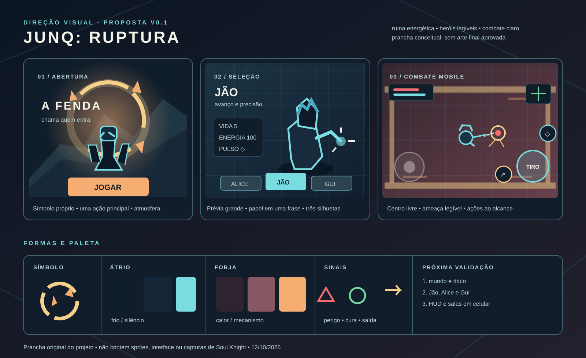

# 06 · Direção visual proposta · v0.1

**Estado:** proposta para validação do MVP em 12/10/2026. Este documento define a linguagem desejada, não declara arte final aprovada. O jogo publicado ainda usa desenhos vetoriais em código e interface provisória. A prancha original [identidade-v1.svg](visual/identidade-v1.svg) ilustra a direção; não é captura da build nem sprite pronto.

## O que foi observado nas oito capturas do Soul Knight

As capturas enviadas pelo MVP mostram uma versão do jogo com muito conteúdo acumulado. A leitura abaixo trata apenas do que aparece nelas; o funcionamento geral de heróis, masmorras em pixel art, mira automática e ações de desviar, disparar e usar habilidade também é descrito pela [ChillyRoom na Google Play](https://play.google.com/store/apps/details?id=com.ChillyRoom.DungeonShooter).

| Capturas | Leitura da interface | Aplicação no Junq |
| --- | --- | --- |
| 1000528918 | Logo e imagem grandes, poucas ações principais na faixa inferior; a abertura anuncia o jogo antes de exigir decisões. | Entrada com uma imagem forte, botão de jogar evidente e opções secundárias discretas. |
| 1000528919 | Seleção dentro de um espaço habitado, com personagens visíveis no próprio cenário. | Futuro hub como lugar pequeno e navegável; elenco reconhecível sem depender de um menu de texto. Começar com uma seleção simples antes de construir o hub. |
| 1000528920–22 | Herói ampliado no centro; ficha de atributos à esquerda, habilidade à direita e elenco embaixo. A silhueta muda bastante entre opções. | Tela de seleção com uma prévia grande, papel de combate em uma frase, vida/energia e habilidade legíveis; diferenças de corpo, cabelo, roupa e cor entre Jão, Alice e Gui. |
| 1000528929 | Área de jogo preservada no centro, recursos na borda superior, controle esquerdo e ações na direita. | HUD contido nas bordas e zona central livre; mira automática, botão de tiro maior, desvio e habilidade separados. |
| 1000528930–31 | A passagem é um corredor visível no mundo; paredes, porta, sombra e minimapa ajudam a entender para onde avançar. | Saída espacial clara; ao atravessar, câmera acompanha e anuncia a região sem esconder perigo ou pedir outro toque. |

**Limite de referência:** usar hierarquia de informação, legibilidade e ritmo de navegação como princípios. Criar logo, sprites, poses, cenário, cores finais, botões, som e animações do zero para este jogo. Não reproduzir o enquadramento, layout exato, ícones, tipografia, personagens, pets ou tiles das capturas.

## Fantasia visual do nosso jogo

**Conceito de trabalho:** um grupo Junq explora uma instalação antiga que rachou em regiões de energia incompatível. O Átrio parece uma estrutura silenciosa de pedra e metal frio; a Forja de Âmbar é seu núcleo superaquecido. Portas e trilhas luminosas sugerem que as salas pertenciam ao mesmo lugar. O mundo reage ao combate: selos acendem, rachaduras pulsam, mecanismos despertam e a saída responde quando a sala é limpa.

**Título de trabalho para discutir:** `JUNQ: RUPTURA`. O nome publicado continua provisório. O símbolo proposto é um **anel incompleto atravessado por três fragmentos**, representando os heróis entrando na estrutura. Esse símbolo pode aparecer no menu, sobre portas e nas marcas de piso, em tamanhos diferentes. É um conceito novo deste projeto, sem usar marcas de outros jogos.

Três regras da identidade:

1. **Herói em primeiro plano.** Silhuetas de leitura rápida, cabeça e gesto expressivos; cada um reconhecível em tamanho de combate, sem precisar de retrato ou legenda.
2. **Ruína energética.** Pedra/metal com circuitos e fendas, evitando tanto castelo medieval genérico quanto laboratório futurista limpo. Padrões discretos no chão deixam os projéteis visíveis.
3. **Ação fácil de decifrar.** Cor, forma e movimento têm funções consistentes. Ataques perigosos mostram origem, direção e tempo antes de atingir.

Tom: aventura ágil com mistério e humor dos personagens, sem terror pesado. A imagem de abertura pode ser mais ilustrada e dramática; o combate usa arte pixelada de contorno controlado. A ligação entre ambos é a mesma paleta, o anel quebrado e as formas de fenda.

## Vocabulário visual

| Função | Cor inicial | Uso |
| --- | --- | --- |
| Fundo profundo | `#101D2B` | Vazios, áreas fora da arena, painéis. |
| Átrio / pedra fria | `#152538`, `#385865` | Piso, pilares e paredes. |
| Energia dos heróis | `#78DCE0` | Marcas aliadas e realce do herói; cada kit acrescenta sua cor própria. |
| Forja / metal quente | `#2E2430`, `#875763` | Piso e estruturas da segunda região. |
| Âmbar / recompensa | `#F5AD72`, `#F5D08A` | Fornalhas, baús e detalhes de destaque. |
| Perigo | `#F46B72` com contorno claro | Ataques inimigos e dano; na Forja, combinar com forma/pulso para não se confundir com o cenário quente. |
| Vida e saída | `#76DBA2` | Cura e porta liberada, sempre com ícone/forma próprios. |
| Texto | `#F4F4E9` | Texto principal com painel escuro sólido atrás. |

A paleta parte dos biomas já implementados, mas os valores finais serão conferidos em tela de celular. Não confiar apenas em cor: perigo usa pontas/linhas pulsantes, recompensa usa brilho pontual, saída usa moldura aberta e seta. O fundo deve ser mais escuro e menos saturado que personagens, projéteis e itens.

**Pixel art planejado:** grade de referência de 32 unidades para cenário; heróis em torno de 32 × 40 unidades e inimigos comuns entre 32 × 32 e 48 × 48; chefe maior. Essas são metas de produção, não tamanho imposto pelo código atual. Desenhar em resolução nativa pequena, ampliar por inteiro sempre que a tela permitir, manter pixels nítidos, sombra de contato e animação curta com poses distintas. A UI pode usar formas vetoriais/texto nítido para funcionar em densidades de tela variadas. Se a escala exata causar recorte em celular, preservar visibilidade da arena e área de toque antes da fidelidade à grade.

## Telas e experiência visual

| Momento | Composição proposta | Informação prioritária |
| --- | --- | --- |
| Abertura | Sombra da instalação ao fundo; anel partido iluminando Jão, Alice e Gui em planos distintos; título no terço superior; um botão principal na metade inferior. | **Jogar**. Continuar só quando houver save implementado; som/opções menores. |
| Seleção | Fundo do Átrio com luz ambiente; personagem selecionado grande ao centro, duas prévias laterais; ficha compacta ao lado e ação Iniciar na borda inferior. | Nome, função em uma frase, vida, energia, habilidade e estado de desbloqueio. Sem ficha enciclopédica. |
| Hub futuro | Oficina/refúgio Junq de escala contida, com três estações visuais: elenco, ajustes e portal. | Iniciar run e entender o próximo objetivo; desbloqueios entram na T011. |
| Combate | Arena ocupa quase toda a tela; HUD nos cantos superiores; joystick recuado da borda inferior esquerda; tiro maior à direita com desvio e habilidade próximos. | Vida, escudo quando existir, energia, recarga, arma, minimapa e ameaça imediata. |
| Baú | O baú real no chão abre com duas opções claras sobre painel curto: **Equipar** ou **Manter**. Fundo da sala permanece visível. | Nome, custo de energia, ritmo e padrão de tiro da arma encontrada comparados com a atual. |
| Passagem | Corredor/porta como parte do mapa; ao cruzar, deslocamento curto de câmera, máscara escura nas bordas e título discreto da sala/região. | Direção da saída e identificação do novo bioma. Nenhum ataque oculto durante a passagem. |
| Chefe e resultado | Arena com moldura própria, barra do chefe no topo; resultado usa o símbolo partido recomposto ou apagado conforme vitória/derrota. | Ameaças sinalizadas no combate; depois seed, tempo, salas, dano e escolha de repetir. |

**Mobile horizontal:** composição base de 960 × 540 unidades lógicas do protótipo, adaptada a proporções e áreas seguras reais. Alvos de toque generosos; botão de tiro sob o polegar direito, desvio acessível sem atravessar a tela, joystick deslocado para dentro e acima da quina. O centro entre os personagens e as portas não recebe painéis persistentes. Em retrato, orientar a girar. Testar alcance dos dedos, texto e contraste em aparelho antes de fixar medidas.

## Personagens: direção, não ficha aprovada

As personalidades, referências fotográficas e poderes **não foram aprovados para este jogo**. Não importar arte ou habilidades de Junq Bullet/Junqverse sem nova validação. Abaixo estão propostas de leitura visual para a seleção e para o sprite de combate.

| Herói | Silhueta e gesto propostos | Assinatura em combate | Ponto a validar |
| --- | --- | --- | --- |
| **Jão** | Postura inclinada para avançar, casaco curto de recortes escuros, mão aberta à frente; cabeça/cabelo bem desenhados contra o ombro. | Fenda luminosa curta saindo da mão, com rastro angular. **Não desenhar arma empunhada no retrato.** Baús continuam dando armas/equipamentos durante a run; a apresentação visual deles será definida com o kit. | Roupa, rosto, cores próprias e como cada arma de baú aparece nele. |
| **Alice** | Perfil mais vertical, mãos claramente separadas do torso e unhas legíveis na arte ampliada. | Traços finos e formas que mudam com a opção de esmalte, sem cobrir a tela com aura contínua. | Formas de esmalte, paleta e função real da habilidade. |
| **Gui** | Corpo e acessórios com massa diferente dos outros dois; pose estável de apoio ou investida, conforme kit escolhido. | Um gesto geométrico próprio, ainda sem elemento/poder presumido. | Referência visual, papel no combate e habilidade antes de produzir frames. |

Regra de produção: validar uma **prancha de três silhuetas + retratos + sprite reduzido** antes de animar. Uma escolha de design da seleção deve continuar identificável quando os três sprites estiverem lado a lado na arena, sem nomes.

## Inimigos, salas e efeitos

- **Perseguidor do Átrio:** massa baixa e pontas laterais; aceleração comunicada por inclinação do corpo e sombra esticada.
- **Atirador do Átrio:** corpo estreito/triangular e núcleo alto; recuo visível antes do disparo.
- **Resistente:** bloco largo e passos pesados, sem confundir com parede ou obstáculo.
- **Sentinela da Forja:** corpo fixo preso à arquitetura, olho central e placas abertas durante os 0,7 s de aviso; três tiros com separação visual clara.
- **Chefe:** ocupar mais espaço e ter núcleo/silhueta próprios; padrões por direção e área, jamais depender só de flash vermelho.

Piso do Átrio: placas frias, veios de luz e inscrições em áreas sem colisão. Piso da Forja: metal queimado, juntas quentes e fuligem, com o trajeto jogável contrastando do fundo. Obstáculo sólido recebe topo iluminado e sombra de contato; decoração baixa nunca parece bloqueio. Porta fechada mostra travas; aberta mostra vão e seta sutil. Baú precisa se distinguir de moeda, inimigo e portal pelo volume e fecho dourado.

Efeitos devem ser breves e ligados à ação: disparo indica origem, acerto destaca contorno, desvio deixa rastro curto, habilidade tem forma exclusiva, dano no herói produz pulso e invulnerabilidade perceptível. Evitar aura permanente, partículas que escondem projéteis ou tremor de câmera longo. Para a Forja, os projéteis da sentinela precisam de borda fria/clara ou forma distinta sobre o chão quente.

## Ordem de produção e aprovação

1. **Validar a direção:** fantasia, título provisório, paleta e composição da prancha. Anotar o que agrada e o que deve mudar.
2. **Personagens:** três silhuetas e retratos conceituais originais; definir kits em `docs/personagens/`; aprovar sprites em escala de combate antes de animação.
3. **Interface:** mockups de abertura, seleção, HUD mobile, baú e resultado com texto real; testar legibilidade em 16:9 e tela mais estreita.
4. **Tiles e inimigos:** folha do Átrio e da Forja, portas/baús, quatro inimigos e chefe, todos com paleta compartilhada; testar contraste em arena com muitos projéteis.
5. **Animação e integração:** estados mínimos parado, mover, disparar, desviar, habilidade, dano e morte; implementar em lotes pequenos, revisar no Pages e registrar créditos/origem.
6. **Validação em aparelho:** controle horizontal, leitura de ataques/portas, desempenho, áudio e transições. Ajustar com partidas reais antes de fechar T009/T010 e entrar no beta.

**Decisões ainda abertas:** título definitivo, tom da narrativa, aparência real dos três heróis, função e habilidade de cada um, relação visual entre armas de baú e ataque de mão do Jão, tipografia final e nível de detalhe dos sprites. A proposta não muda as regras jogáveis já implementadas.
