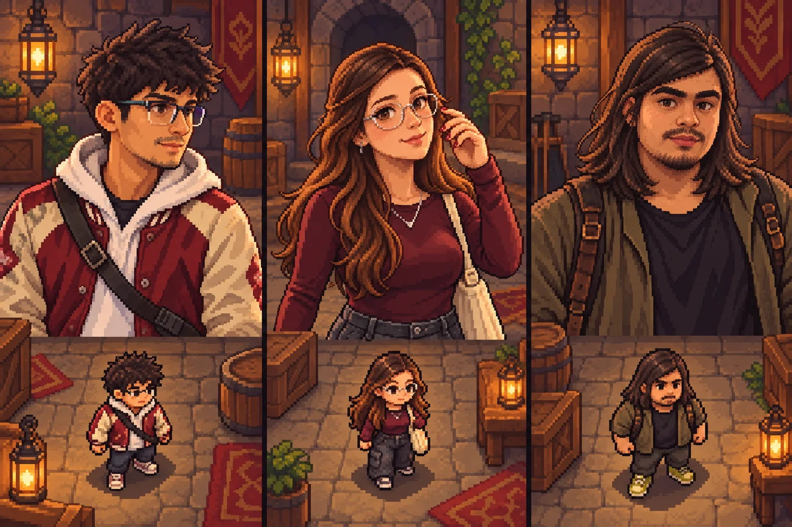
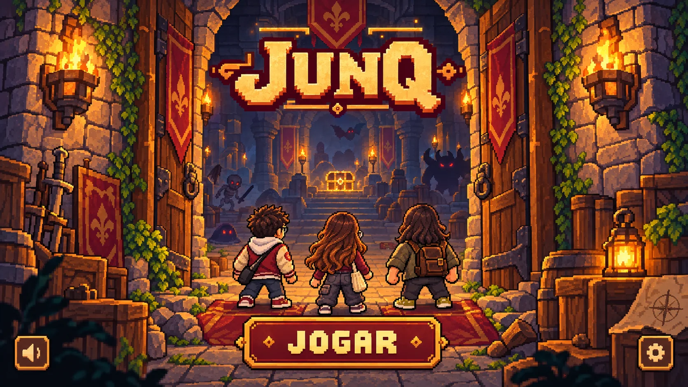
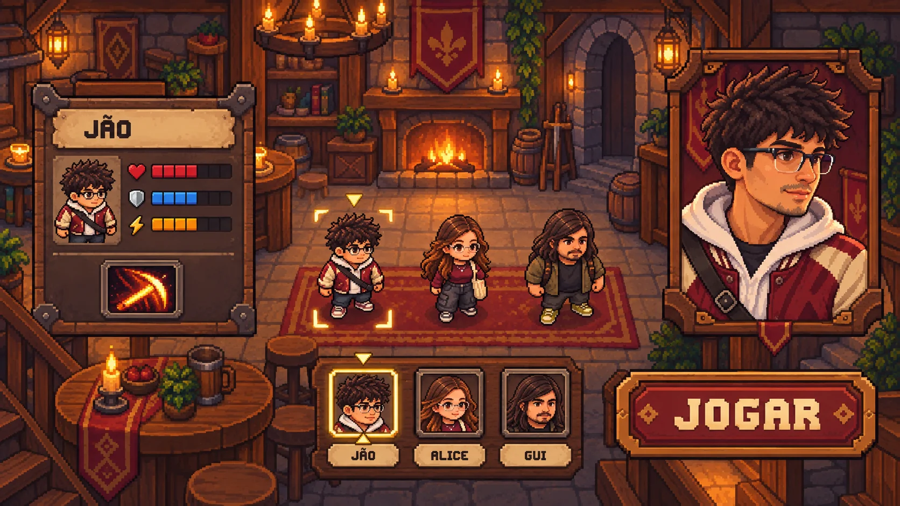
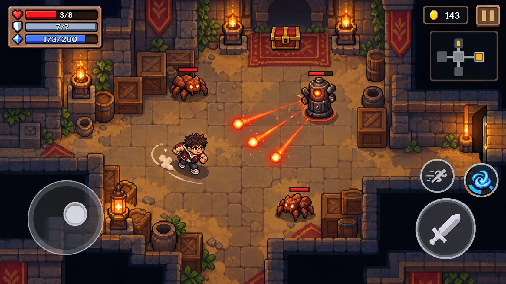

# 06 · Direção visual · pixel art de aventura (v0.2)

**Estado em 12/10/2026:** o MVP aprovou com entusiasmo esta direção. Os quatro mockups abaixo continuam sendo referências conceituais, não capturas da build. A primeira integração jogável produz assets próprios em `src/assets/`: abertura, taverna, salas do Átrio e da Forja e sprites estáticos do trio. Os inimigos são desenhos de pixels em código. O nome `Junq SoulKnight` permanece como nome de trabalho; `JUNQ: RUPTURA` foi descartado.

**Armas integradas, revisão aprovada:** as três [pranchas do Jão](visual/jao-arma-aprovada.webp), [Alice](visual/alice-arma-aprovada.webp) e [Gui](visual/gui-arma-aprovada.webp) foram aprovadas pelo MVP após rejeitar as armas flutuando sobre os sprites. A arma agora faz parte da pose e do figurino: Jão empunha espada e leva bainha nas costas, Alice segura arco e carrega aljava, Gui segura cartas pequenas e usa estojo de couro. As folhas de origem ficam em `art/sheets/`; os PNGs reduzidos são gerados por `scripts/build_approved_sprites.py`. Os efeitos de ataque existentes foram preservados.

**Correção de proporção:** ao ver a build, o MVP apontou que Alice e Gui pareciam altos diante do Jão. As novas matrizes `alice-chibi.webp` e `gui-chibi.webp` usam cabeça maior, tronco e pernas mais curtos e mãos/calçados mais largos. As três silhuetas têm agora altura de frame semelhante; frente, caminhada, costas e ataque seguem a mesma régua. Esta revisão visual ainda aguarda retorno do MVP na tela do celular.

**Exploração pendente de validação:** a primeira rodada para a sintonia total de Raio foi rejeitada por preservar demais o uniforme. A [segunda rodada](visual/jao-raio/v2/README.md) transforma de forma mais clara roupa, silhueta e espada do Jão; ainda não foi aplicada na build.

## O que queremos sentir

Três pessoas reais, Jão, Alice e Gui, entram numa masmorra fantástica e enfrentam salas curtas cheias de inimigos, altares e decisões de afinidade. O visual deve ser **pixel art nítida, expressiva e acolhedora**, com paredes de pedra, madeira, tochas, tapetes, baús e monstros inventados para este jogo. Os momentos de perigo continuam claros em uma tela de celular na horizontal.

As oito capturas de Soul Knight enviadas pelo MVP orientam o **ritmo visual**: abertura marcante, seleção que dá destaque a um personagem, HUD nos cantos, botões grandes sob os polegares e passagem espacial entre salas. A [descrição oficial da ChillyRoom](https://play.google.com/store/apps/details?id=com.ChillyRoom.DungeonShooter) também aponta pixel art, heróis distintos, masmorras e mira automática. Nenhuma captura, sprite, logo, tile, ícone, fonte ou interface do jogo de referência foi incorporado.

**Mudança em relação à v0.1:** abandonar anel energético, circuitos, painéis de ficção científica, néon e silhuetas abstratas. A Forja de Âmbar pode continuar como sala quente de pedra, carvão, metal batido e fogo; o Átrio vira ala de pedra fria, madeira e tochas. O código atual dos biomas permanece como está até os assets definitivos serem aprovados e integrados.

## Quatro imagens para validar a direção

### Elenco inspirado nas fotos enviadas pelo MVP

Da esquerda para a direita: **Jão** com cabelo curto, óculos e jaqueta vinho/creme sobre moletom claro; **Alice** com cabelo castanho longo, óculos, blusa vinho e calça escura; **Gui** como homem de cabelo comprido, barba/bigode e roupa escura. A foto de Gui em corpo inteiro e a foto de rosto são do mesmo personagem. Os retratos ajudam a validar semelhança; os sprites menores ajudam a validar leitura durante o combate. Roupas são ponto de partida, não skins finais obrigatórias.

### Abertura

Título curto em pixel art, três amigos vistos de costas diante de portas de pedra e madeira, luz de tocha e um único **JOGAR** em destaque. O texto `JUNQ` é provisório. Sem botões para modos, coop ou continue que ainda não existem.

### Seleção de personagem

O trio aparece junto no salão; tocar numa miniatura muda o herói destacado, seu retrato, sua ficha curta e o botão de iniciar. A imagem usa Jão selecionado. As barras e o ícone de habilidade são **decorativos no mockup** e não representam atributos ou poderes aprovados. Na implementação, só mostrar valores reais definidos nos kits.

### Combate no celular horizontal

Sala jogável no centro; vida, defesa se existir e energia no canto superior esquerdo; moeda, pausa e minimapa à direita; joystick deslocado para dentro da quina inferior esquerda; tiro grande, desvio e habilidade sob o polegar direito. O mockup mostra uma arma/ícone ilustrativo e números fictícios: **não define equipamento, vida, moedas nem o ataque do Jão**. A mira é automática ao segurar o botão de tiro, e o disparo continua consumindo energia. O MVP substituiu os baús de armas por altares de afinidade após combate; cada herói começa com equipamento próprio.

## Regras de arte para produção

| Elemento | Direção |
| --- | --- |
| Pixel art | Formas criadas em grade pequena com pixels quadrados e clusters deliberados, sem pincel macio, blur ou contorno vetorial. Escala consistente entre personagens e cenários. |
| Personagens | Cabeça expressiva, corpo compacto, sombra curta e duas ou três marcas reconhecíveis da pessoa mesmo quando o sprite é pequeno. Não trocar cabelo/óculos/porte entre retrato e sprite. |
| Átrio | Pedra azul-acinzentada, madeira gasta, tochas mais discretas, piso simples com decoração nas bordas. |
| Forja | Pedra escura, ferro martelado, brasas âmbar, fuligem e braseros; projéteis inimigos com contorno/forma contrastantes contra o chão quente. |
| Inimigos | Monstros próprios com silhuetas distintas: perseguidor baixo, atirador fino, resistente largo e sentinela fixa. Barra de vida apenas quando ajuda a entender o encontro. |
| Objetos | Baú com fecho visível e brilho contido; porta travada e aberta com formas diferentes; moeda, cura e saída não dependem só da cor. |
| Interface | Molduras de madeira, pedra ou pergaminho; texto pixelado **legível** sem linhas longas durante a ação. Números reais da build substituem os mockups. |
| Efeitos | Disparo, acerto, desvio e aviso de ataque breves e claros. Nada de aura permanente cobrindo o personagem ou bala. |

**Escala inicial para testar:** tiles em grade lógica de 32 × 32, heróis em torno de 32 × 40, sprites de inimigos conforme porte; validar no canvas atual de 960 × 540 e em proporções de celulares. Não escalar sprites com filtragem suave. Os mockups têm muito mais detalhe que um sprite real nessa grade, então a arte final precisa ser redesenhada em folhas separadas, com frames, fundo transparente e colisão definida.

## Fluxo visual do jogo

1. **Abertura:** JOGAR leva à seleção; opções e som ficam discretos.
2. **Seleção:** três personagens visíveis. Ficha mostra papel e habilidade real quando o kit existir; a opção escolhida inicia a run.
3. **Átrio:** primeira sala ensina movimento, mira automática e consumo de energia sem tutorial longo.
4. **Combate e altar:** portas fecham no encontro, abrem quando limpa; altar mostra três elementos e seus níveis seguintes.
5. **Corredor:** atravessar uma saída conecta as salas e a câmera acompanha por um instante; novo bioma é apresentado por mudança de material, cor e som, sem tela de carregamento longa.
6. **Forja e chefe:** inimigos e padrões de tiro sobem em complexidade; chefe tem barra e avisos visuais; resultado mostra seed, tempo e progresso.

**Prioridade mobile:** botões sob os dedos sem tampar Jão ou a porta, texto curto que caiba em tela estreita, safe areas e contraste das balas em ambas as regiões. Quando o usuário testar, ajustar posições pelo alcance real dos polegares.

## Próximas aprovações e implementação

1. **Aprovado pelo MVP:** tom de aventura, trio e direção em pixel art. Refinar semelhança, roupa e escala antes de animar.
2. Definir kits e ataque básico próprios deste jogo. Cada herói tem equipamento inicial próprio; recompensas da run são afinidades elementais no altar.
3. Produzir separadamente sprites reais em escala de jogo, vistas e frames, tiles do Átrio/Forja, monstros e componentes de UI. O gerador de imagens serve ao conceito, não substitui pixel art editável validada frame a frame.
4. Integrar abertura, seleção e HUD em lotes pequenos no Pages; testar jogo, controles e leitura visual no Android antes de fechar T009/T010.

**Procedência:** conceitos gerados com a ferramenta de imagem do projeto usando quatro fotos enviadas pelo MVP como referência de identidade e as capturas de Soul Knight apenas como referência de gênero/hierarquia. As fotos originais não são publicadas no repositório. As imagens de conceito foram aprovadas como direção. Assets de produção são derivados/recriados para uso no jogo, com botões e textos interativos desenhados por código. Não reutilizar sprites ou habilidades de Junq Bullet ou Junqverse automaticamente.
