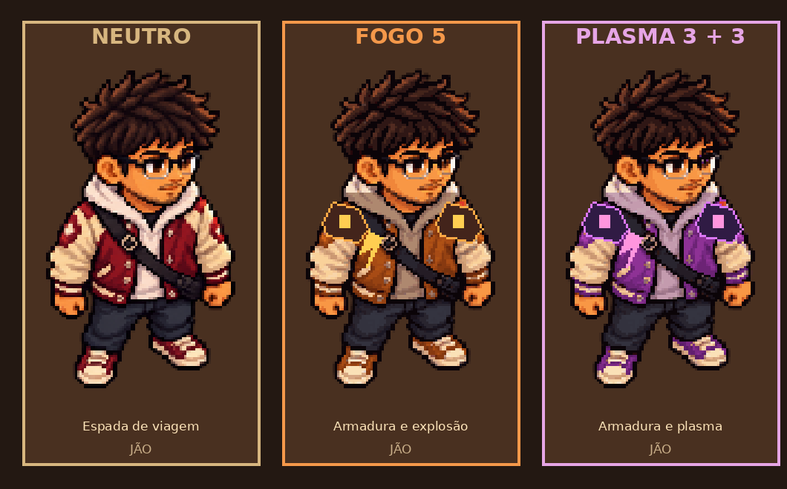

# 08 · Masmorras, relíquias e primeira sinergia

## Contrato da primeira versão jogável

A run começa em **mundo 1, fase 1/5**. Cada mundo tem cinco encontros em sequência. O chefe é sempre **5/5**. Vencê-lo abre a passagem para a próxima masmorra mantendo HP, escudo, energia, relíquias, moedas e afinidades. Os mundos 1, 2 e 3 usam respectivamente Átrio, Forja de Âmbar e Cripta das Velas. A Cripta usa provisoriamente a arte do Átrio com outra paleta; precisa de cenário próprio.

| Fase de cada mundo | Recompensa depois do combate |
| --- | --- |
| 1/5 | Baú: escolha uma relíquia entre três. |
| 2/5 | Altar: escolha um elemento entre três. |
| 3/5 | Baú: escolha uma relíquia entre três. |
| 4/5 | Altar: escolha um elemento entre três. |
| 5/5 | Chefe. Após os mundos 1 e 2, passagem; ao terminar o 3, encerrar ou continuar. |

O mapa das cinco etapas e os obstáculos variam por seed; o percurso dentro de cada mundo é linear nesta versão. No fim do mundo 3, o jogador decide encerrar a expedição com vitória ou seguir. Mundos seguintes repetem a estrutura de cinco fases e alternam as três paletas provisórias, sem novo conteúdo exclusivo. Isso é uma validação de loop, não um lançamento com mundos infinitos prontos.

## Baú de relíquias

Armas não são sorteadas. Jão inicia com espada, Alice com arco e Gui com cartas. As armas aparecem nas mãos durante o movimento. O ataque básico do Jão é um corte em arco de alcance 120, sem projétil; Alice dispara uma flecha por comando e Gui lança cartas de naipes alternados. Todos conservam mira automática e custo de energia. Uma escolha do baú vale até o fim da run. Ofertas dependem da seed e da sala; a mesma relíquia pode subir até nível 5.

| Relíquia | Efeito por nível |
| --- | --- |
| Anel Vital | +1 vida máxima e cura imediata de 1. |
| Armadura | +1 escudo; escudo absorve dano antes da vida e volta ao máximo após 8 segundos sem dano. |
| Pingente | +20 de energia máxima e restaura 20 ao escolher. |
| Runa de Fluxo | +20% na regeneração de energia. |

## Afinidade e evolução

São sete elementos, todos em zero no começo. Os altares das fases 2 e 4 oferecem seis fragmentos até o chefe do mundo 3. Dois elementos já investidos permanecem entre as três opções quando ainda podem crescer; a terceira varia. Isso permite perseguir 3 + 3 sem depender de sorte depois da decisão inicial.

- **Jão Fogo 5:** roupa muda para casaco de tons de carvão e brasa, com ombreiras; a habilidade faz um corte e uma explosão em torno do alvo. As poses frontal, traseira e laterais recebem a mesma transformação. É a primeira evolução visual prototipada, sem aura externa.
- **Jão Raio 5:** mantém o corte que atravessa o alvo e termina atrás dele quando há espaço.
- **Plasma, Fogo 3 + Raio 3:** ataques rosados mais rápidos e fortes; habilidade ganha impacto aumentado. A forma do Jão muda para casaco violeta com detalhe luminoso. O efeito de cada herói usa sua arma original; a espada continua um corte corpo a corpo.
- **Lodo, Água 3 + Terra 3:** tiros esverdeados causam lentidão breve; a habilidade causa lentidão maior na área ou alvo atingido.

As outras misturas continuam com o bônus híbrido de dano e cor alternada. Elas **ainda não recebem nome, status ou habilidade exclusivos no código**. Se algum elemento chega a nível 5, o domínio puro tem prioridade sobre uma sinergia ativa. As árvores completas de cada herói, os pares restantes e os designs de outras formas são a próxima expansão, sujeitos a playtest.

## Aceite desta etapa

1. Começar com 0, ver 1/5 a 5/5, limpar uma sala, escolher relíquia e depois escolher afinidade.
2. O chefe em 5/5 abrir o mundo seguinte com a construção preservada. Mundo 3 oferecer encerrar ou continuar.
3. Seis altares até mundo 3, fase 4; Fogo 3 + Raio 3 ativar Plasma, Água 3 + Terra 3 ativar Lodo, e Fogo 5 manter seu domínio próprio.
4. Gui lançar cartas com naipe, Alice flecha reconhecível, Jão cortar de perto sem projétil; armas visíveis nas mãos e ataque com mira automática e custo de energia.
5. Seed repetir layout e ofertas. Verificar interface no Pages desktop; Android físico permanece validação do beta.
